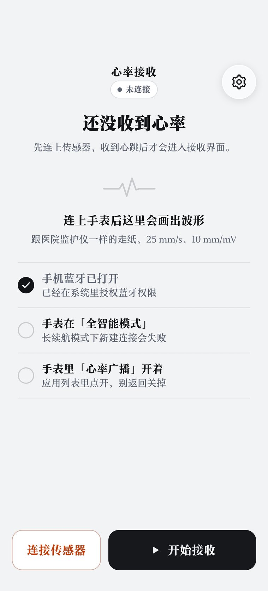
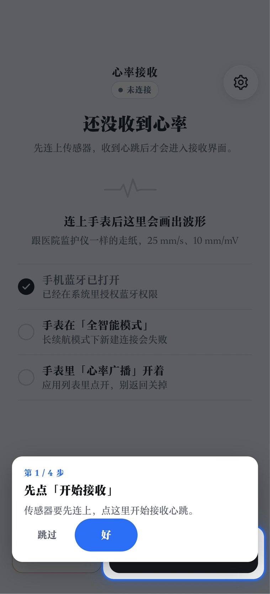
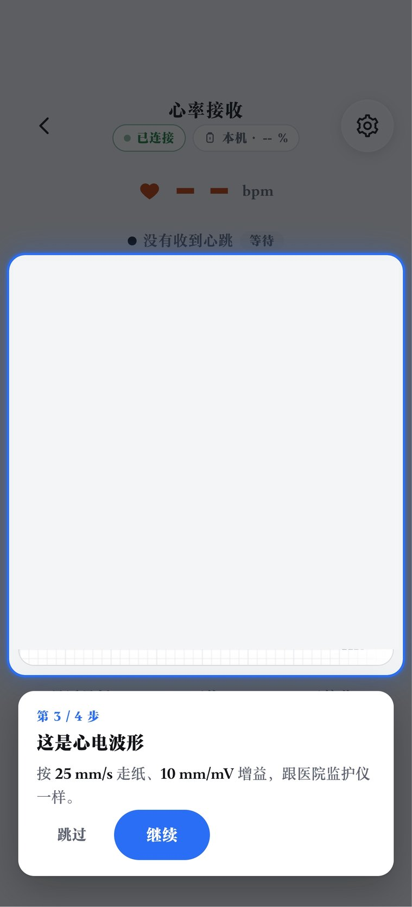

# 心率接收 · Heart Monitor


用蓝牙收手表的心率，用医院监护仪的样子显示出来。

安卓 App，Kotlin 原生壳 + WebView 界面。接收标准 BLE 心率服务（GATT `0x180D` / `0x2A37`）的广播，画成一张像心电图纸的监护界面。

> **不是医疗器械。** 不做诊断，不做告警，不替代任何医疗设备。
>
> **波形不是真实心电信号。** 蓝牙心率标准只提供 BPM 一个数字，波形是按真实心率数学合成的（心率快慢会改变波形的密度和形态，但波本身不是从身体采集的电信号）。



## 功能

| 功能 | 说明 |
|---|---|
| **蓝牙心率接收** | 扫描广播标准心率服务的手表，连上后订阅心率特征，实时收到 BPM |
| **监护仪界面** | 大号心率数字 + 心电波形 + 最低/平均/时长统计 |
| **波形跟随心率** | 心率变快波形变密、R 波变高、T 波压低，变慢反之 |
| **断线检测** | 10 秒收不到心跳自动判定断开 |
| **本机电量** | 顶栏显示手机剩余电量，低于 20% 标红 |
| **新手引导** | 4 步跨页面引导，走完不再出现 |
| **停止后保存** | 停止接收或断线后，可把这段波形存成图片 |
| **开发者选项** | 假传感器、工作日志、手动心率、强制断开、自检修复、诊断包导出等 10 个工具 |

## 截图

| 引导 1/4 | 引导 3/4 · 波形 |
|---|---|
|  |  |

## 技术栈

| 层 | 技术 |
|---|---|
| 原生 | Kotlin、Android SDK 35、minSdk 30（Android 11） |
| 界面 | 原生 HTML / CSS / JavaScript，无框架 |
| 蓝牙 | Android BLE API（`BluetoothLeScanner` + `BluetoothGatt`） |
| 构建 | Gradle 8.9 + Kotlin DSL |

选 WebView 套壳的原因：界面用网页做，排版灵活（CSS Grid/Flex 做监护仪布局很顺手），蓝牙这种底层能力交给原生。桥接只有一层：`window.HeartNative`。

## 项目结构

```
HeartApp/
├─ app/src/main/
│  ├─ java/com/example/heart/
│  │  ├─ MainActivity.kt     WebView 壳、JS 桥、权限申请、电量、console 捕获
│  │  └─ BleHeart.kt         蓝牙扫描、连接、服务发现、心率解析、断线检测
│  ├─ assets/                全部网页界面
│  │  ├─ index.html          主接收界面
│  │  ├─ waiting.html        等待接收
│  │  ├─ connect.html        设备扫描
│  │  ├─ settings.html       设置 + 开发者选项
│  │  ├─ devlog.html         工作日志
│  │  ├─ native.js           原生桥 JS 封装
│  │  └─ native-hook.js      原生事件接线
│  ├─ res/                   图标、主题、字符串
│  └─ AndroidManifest.xml
├─ build.gradle.kts
└─ settings.gradle.kts
```

## 编译

需要 JDK 21、Android SDK platform 35、Gradle 8.9。

```bash
# 先建 local.properties（不进版本库）
cat > local.properties <<'EOF'
sdk.dir=/path/to/AndroidSdk
storeFile=my-release.jks
storePassword=你的密码
keyAlias=你的别名
keyPassword=你的密码
EOF

gradle assembleRelease --no-daemon
```

产物在 `app/build/outputs/apk/release/`。

不配签名也能编译，只是产出未签名的包。生成自己的 keystore：

```bash
keytool -genkeypair -v -keystore my-release.jks -keyalg RSA -keysize 2048 \
        -validity 10000 -alias myalias
```

> 提示：Windows 上 Gradle 守护进程容易 socket 超时，加 `--no-daemon` 更稳。

## 使用

1. **手表端**：进应用列表打开「心率广播」，保持在「全智能模式」（长续航模式下广播可能不开）
2. **手机端**：打开 App →「连接传感器」→ 等扫描出设备 → 选你的手表
3. 连上后自动进入接收界面，心率数字开始跳动

任何广播标准心率服务 `0x180D` 的手表/手环都能用。已实测 OPPO Watch X2；华为、小米、Apple Watch 等大多支持这个标准，部分品牌需要在手表端手动开「心率广播」。

首次启动要两个权限，**都要给**：

- **附近设备**（`BLUETOOTH_SCAN` / `BLUETOOTH_CONNECT`）——不给就扫不到手表
- **定位**（`ACCESS_FINE_LOCATION`）——部分 ROM 即使有附近设备权限仍会检查这一项

## 已知限制

- 波形是合成的，不是真实心电
- 横屏是开发者选项，默认关闭，且用 CSS 旋转实现，存在点击坐标偏移风险
- 同一时间只能连一台手表
- 关闭 App 后数据不保存

## 踩过的坑

写在了 [`项目说明.md`](项目说明.md) 第八节，这里挑三条最容易踩的：

1. `BLUETOOTH_SCAN` 少了 `android:usesPermissionFlags="neverForLocation"`，Android 12+ 会静默丢弃所有扫描结果，**没有任何报错**
2. 扫描回调里读 `device.name` 会触发同步远程读取，在 ColorOS 上会卡住回调线程导致识别失败——只读 `scanRecord.deviceName`
3. Android WebView 禁用 `screen.orientation.lock()`，横屏只能 CSS 旋转，且 Manifest 必须锁死 `portrait`，否则系统转 + CSS 转 = 转了 180°

## 许可

[MIT](LICENSE)。「心率接收」名称与应用图标版权保留，不在 MIT 授权范围内。

**不是医疗器械，不用于诊断、治疗或任何医疗决策。**
